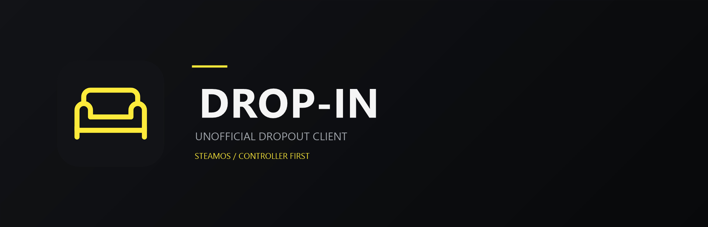

# Drop-In for SteamOS (Unofficial)



An unofficial, controller-first client for Dropout on Linux and SteamOS, built for a Steam Machine.

**v0:** Electron shell, spatial navigation, focus ring, and a player remote. The site renders untouched apart from three surgical rules: a focus outline, cursor hiding, and hiding the catalog hero. No other layout, typography, or carousel overrides.

Unofficial. Not affiliated with Dropout.

## Install

The AppImage is the only published build. It installs under your home folder,
and SteamOS system updates leave it alone.

In Desktop Mode, with Steam running:

```sh
curl -fsSL https://github.com/Winde/dropout-steamos/releases/latest/download/install.sh | bash
```

Prefer to read it first:

```sh
curl -fsSLO https://github.com/Winde/dropout-steamos/releases/latest/download/install.sh
less install.sh
bash install.sh
```

The installer downloads and verifies the AppImage, installs it to
`~/Applications/Drop-In.AppImage`, adds a Steam shortcut, and applies the library
artwork. `--no-steam` installs without the shortcut, `--version vX.Y.Z` pins a
release, `--force-art` replaces artwork you changed in Steam, and `--uninstall`
removes the local files. The full guide, including the manual steps and
troubleshooting, is [docs/install-steamos.md](docs/install-steamos.md).

Set the shortcut's controller layout to **Gamepad** once: the installer cannot
choose it for you. The app reads a standard gamepad.

Drop-In updates itself from inside the app. The storefront header carries a
**Drop-In vX.Y.Z / Check for updates** stamp; **Y** on a controller opens the
same dialog from anywhere outside the player. **Update now** downloads the
release, checks it against `SHA256SUMS.txt`, and restarts into it. Nothing
installs on its own. A build from before this feature has no updater, so
upgrade it once with the installer; after that the app keeps itself current.

The installer remains the fallback: re-run it for a first install, a machine
without write access to the AppImage, or to repair one. It replaces the AppImage
in place, so the Steam entry and its artwork stay valid.

## Run

```bash
npm install
npm start
```

If Electron reports a `chrome-sandbox` permission error on Linux, run `npm start -- --no-sandbox`.

- `npm start -- --fullscreen` — fullscreen
- `npm start -- --devtools` — open devtools
- `npm test` — navigation/page-routing unit tests
- `npm run typecheck` — TypeScript check
- `npm run verify` — typecheck and tests
- `npm run build:linux` — AppImage (run on Linux or CI)

Requires Node 22+ and a Dropout account.

## Modifications

Every change to Dropout is a **mod** in `src/tv/mods/`. The single registry is
`src/tv/mods/index.ts`; registry order is priority for actions and focus. A mod
can contribute CSS, run before the page parses (`early`), set up listeners,
choose initial focus, consume controller actions or row edges, and refine the
focusable list. One mod is one independently removable behaviour: split
unrelated tweaks into separate mods even when they share a page. Add a file and
one line to add a change; delete the line to remove it. The Electron shell
settings (window, locale, permissions, updater) stay in `src/main/`.

The version/update line is itself a mod: `src/tv/mods/updates.ts` injects the
header entry and opens the shadow-DOM dialog. `src/main/updater.ts` does the
GitHub check and the verified AppImage swap behind IPC.

## Steam Machine

1. Add the app as a non-Steam game (or run `npm start` from Desktop Mode once to verify).
2. Set launch options to `--fullscreen`.
3. Set the controller layout to **Gamepad**.
4. Sign in once from the site header: focus **Sign In** with the D-pad, then press **Steam + X** for the on-screen keyboard. D-pad down leaves the field for **Next** / **Sign in**, and **B** steps back: password to email, then out to the previous page.

## Controls

| Action | Gamepad | Keyboard |
| --- | --- | --- |
| Move | D-pad / left stick | Arrow keys |
| Select | A | Enter |
| Back | B / Back | Escape |
| Search | X | `/` |
| Play / pause | A | Space |
| Seek ±10s | D-pad left / right | ← / → |
| Change dropdown (season, sort, language) | A opens picker; up/down moves; A confirms, B closes | Enter opens picker; ↑/↓ moves; Enter confirms, Esc closes |
| Seek ±1min | LT / RT | — |
| Player controls | D-pad up / down, Y / Start | ↑ / ↓, M |
| Check for updates | Y (outside the player) | Y (outside the player) |
| Quit | B on Home | Ctrl+Q |
| Fullscreen | — | F11 |

Extras: **X** toggles subtitles, **L3** mutes. When the player controls are open, D-pad left/right moves the focus, **A** activates, **B** closes.

## Releases

A release is a tag. Pushing a `vMAJOR.MINOR.PATCH` tag builds and tests the
commit, writes the notes from the commits since the previous release, and
publishes a release named after the tag with the AppImage, `install.sh`,
`steam-art.zip` and `SHA256SUMS.txt`. Nothing is created by hand. The workflow
can also be run with `dry_run` on any commit to build and test everything
without touching a release. See [docs/releasing.md](docs/releasing.md) for the
notes rules, versioning and the checklist.

## Credits

The app icon is Iconoir's `sofa` (MIT, Copyright (c) 2021 Luca Burgio),
recoloured, rescaled and padded. See [THIRD-PARTY-NOTICES.md](THIRD-PARTY-NOTICES.md) and
[licenses/iconoir.txt](licenses/iconoir.txt).

## License

MIT for Drop-In's own code. See [LICENSE](LICENSE). Dropout, its service and
its content are not covered by this license and remain the property of their
owners. Third-party components keep their own licenses; see
[THIRD-PARTY-NOTICES.md](THIRD-PARTY-NOTICES.md).
